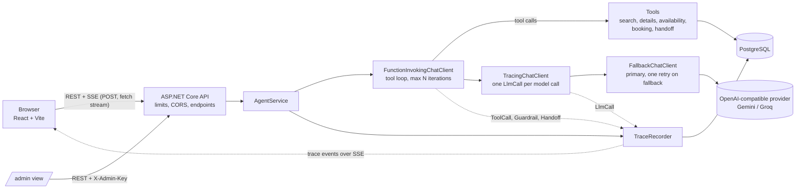

# AI Booking Agent (.NET + React)

A WhatsApp-style assistant for small businesses: a real tool-calling agent that searches a catalog, checks availability, registers bookings and orders in PostgreSQL and hands off to a person, with a live **"Show agent trace"** panel that shows every model call, tool call, token count and cost behind each answer.

- **Live demo:** _pending: the public deploy does not exist yet (hosting provider not decided)._
- **Demo GIF (20-30 s, full booking with the trace panel open):** _pending: to be recorded._

The visitor picks one of three businesses, each with its own persona, catalog and rules:

| Niche | Persona | Business |
|---|---|---|
| Real estate | Sofia | PrimeHaven Realty |
| Dental clinic | Alex | Smile Dental Clinic |
| Restaurant | Nico | Luigi's Pizzeria |

## What this demonstrates

- **Real tool calling.** Five tools (`search_catalog`, `get_offering_details`, `check_availability`, `create_booking`, `handoff_to_human`) read and write PostgreSQL. A booking is a row, not a sentence. The business and session a tool acts on come from the server, never from model arguments, so the model cannot touch another business's data.
- **Trace and cost per turn.** Every model call and tool call of a run is stored and streamed live: model and provider, tokens in/out, latency, tool arguments and results, and the cost (`tokens x ModelPricing`).
- **Human in the loop.** The agent only registers bookings as `PendingConfirmation` and must say so ("registered, pending confirmation"). `handoff_to_human` creates a handoff request, moves the session to `AwaitingHuman` and shows a banner. Both appear in `/admin`.
- **Rules in code, not in the prompt.** Slot capacity (atomic `UPDATE ... WHERE booked < capacity` plus CHECK constraints), booking idempotency (unique key), order totals computed on the server, iteration and output-token caps, and phone masking in the public trace. The model interprets text and picks tools; it does not decide whether there is room or what an order costs.
- **Idempotency and concurrency.** Retrying a booking does not duplicate it; concurrent attempts on the last seat have exactly one winner (tested against a real PostgreSQL).
- **Rate limiting and abuse limits on the server.** Per IP, per session and a global daily cap, plus explicit CORS and startup checks for unsafe configuration.
- **Deterministic language handling.** The reply language is detected per turn in code and injected as the last system message (the previous version of this project answered English messages in Spanish).
- **Evals.** 36 scripted conversations in 10 categories (language, search, availability, booking, order, not-in-catalog, handoff, small talk, prompt injection, gibberish) run by a console harness against a real model.
- **Provider fallback.** A primary and a fallback OpenAI-compatible provider; the fallback takes over on 429/5xx before the first token.

Status: everything above is covered by tests that use a scripted fake model and a real PostgreSQL (Testcontainers). It has **not** yet been run end to end against a real LLM provider; see [Known limitations](#known-limitations-and-next-steps).

## Architecture



The model client is built per request, outermost first: `FunctionInvokingChatClient` (runs the tools) -> `TracingChatClient` (sees each individual model call, which is why it sits *below* function invocation) -> `FallbackChatClient` -> OpenAI-compatible client. Details, the SSE contract and the trace format are in [docs/architecture.md](docs/architecture.md).

**Repo layout**

```
api/
  src/Chatbot.Api             ASP.NET Core minimal API: endpoints, SSE, limits, CORS, DI
  src/Chatbot.Core            pure logic: domain, language detection, cost, phone masking, prompt text
  src/Chatbot.Infrastructure  EF Core + migrations + seed, tools, AgentService, tracing, LLM client + fallback
  tests/Chatbot.Tests         unit + integration (WebApplicationFactory, Testcontainers PostgreSQL, fake IChatClient)
evals/
  Chatbot.Evals               console harness that runs the cases against the agent and a real model
  cases/*.yaml                36 evaluation cases
web/                          React 19 + Vite + TypeScript + Tailwind, Vitest tests
docs/                         architecture.md, decisions.md (ADRs), progress.md, seed-notes.md
docker-compose.yml            postgres + api + web
.env.example
```

## Stack

| Layer | Technology |
|---|---|
| Backend | .NET 10, ASP.NET Core minimal APIs, SSE for streaming |
| AI | `Microsoft.Extensions.AI` (`IChatClient`, function invocation) + `Microsoft.Extensions.AI.OpenAI`; any OpenAI-compatible endpoint (default: Gemini primary, Groq fallback) |
| Data | EF Core 10 + Npgsql, PostgreSQL 17, `jsonb` for catalog attributes and trace payloads |
| Frontend | React 19, Vite, TypeScript (strict), Tailwind, Vitest; hooks and context, no state library |
| Tests | xUnit, `WebApplicationFactory`, Testcontainers (PostgreSQL), scripted fake `IChatClient` |
| Infra | Docker Compose (postgres, api, web behind nginx), GitHub Actions CI (api build + tests, web lint + tests + build) |

## Run it locally

Requirements: Docker with Compose, and an API key for an OpenAI-compatible provider (a free Gemini key works; Groq is optional, for the fallback).

```bash
cp .env.example .env          # then set LLM_PRIMARY_API_KEY and LLM_PRIMARY_MODEL in .env
docker compose up --build
# open http://localhost:3001
```

`LLM_PRIMARY_MODEL` has no default: pick a model of your provider that supports function calling (the repo seeds a `ModelPricing` row for `gemini-3.5-flash-lite`; other models run but show cost 0). In Development the API applies the migrations and seeds the three businesses (28 offerings, 14 days of slots) on start. Ports: web http://localhost:3001, API http://localhost:8080 (`/health`), PostgreSQL 5432.

### Configuration

Set in `.env` (read by `docker-compose.yml`). Never commit `.env`.

| Variable | Default | Purpose |
|---|---|---|
| `LLM_PRIMARY_API_KEY` | _empty_ | API key of the primary provider. Required: without it the chat answers with an error event |
| `LLM_PRIMARY_MODEL` | _empty_ | Model name of the primary provider. Required |
| `LLM_PRIMARY_BASE_URL` | Gemini OpenAI-compatible endpoint | Any OpenAI-compatible base URL |
| `LLM_FALLBACK_API_KEY` | _empty_ | Fallback provider key. Empty: no fallback |
| `LLM_FALLBACK_MODEL` | _empty_ | Fallback model name (required if a fallback key is set) |
| `LLM_FALLBACK_BASE_URL` | Groq OpenAI-compatible endpoint | Fallback base URL |
| `CORS_ALLOWED_ORIGIN` | `http://localhost:3001` | Allowed frontend origin(s), comma-separated, exact match, no wildcard |
| `ADMIN_KEY` | _empty_ | Value of the `X-Admin-Key` header for `/api/admin/*`. Empty: admin endpoints answer 503 |
| `ADMIN_MASK_PHONES` | `true` | Mask customer phones in the admin bookings list |
| `IP_HASH_SALT` | _empty_ | Salt for the stored client-IP hash. Set a long random value outside local development |
| `AGENT_MAX_OUTPUT_TOKENS` | `800` | Output-token cap per model call |
| `AGENT_MAX_ITERATIONS` | `5` | Tool rounds per user message |
| `RATE_LIMIT_IP_MESSAGES` | `30` | Messages per client IP per window |
| `RATE_LIMIT_IP_WINDOW_MINUTES` | `10` | Window of the per-IP limits |
| `RATE_LIMIT_IP_SESSIONS` | `20` | New sessions per client IP per window |
| `RATE_LIMIT_SESSION_MESSAGES` | `25` | User messages per session in total |
| `RATE_LIMIT_DAILY_REQUESTS` | `500` | Agent runs per UTC day, all visitors |
| `SECURITY_TRUSTED_PROXY_CIDR` | loopback + private ranges | Proxies whose `X-Forwarded-For` is trusted; in production list only your proxy |
| `POSTGRES_DB` / `POSTGRES_USER` / `POSTGRES_PASSWORD` | `chatbot` | Database credentials for the compose postgres |
| `WEB_PORT` | `3001` | Host port of the web container (read by compose; not in `.env.example`) |

### Tests

```bash
cd api && dotnet test      # unit + integration; needs Docker running (Testcontainers starts PostgreSQL)
cd web && npm test         # Vitest (SSE parser, WhatsApp formatting, chat reducer, trace helpers, admin page)
```

CI (GitHub Actions) runs the API build and tests, and the web lint, tests and build, on every push and pull request. The tests use a scripted fake model: no network, no API key.

### Admin view

Open http://localhost:3001/admin. It lists bookings and handoff requests (filterable by niche, with a link to the trace of each session) and asks for the key you set as `ADMIN_KEY`; the browser keeps it in `sessionStorage` and sends it as the `X-Admin-Key` header. With `ADMIN_KEY` empty the endpoints answer 503 and the page says the admin is disabled. The same data over HTTP:

```bash
curl -H "X-Admin-Key: $ADMIN_KEY" 'http://localhost:8080/api/admin/bookings?niche=dental'
```

This is **demo-grade protection**: one shared key compared in constant time, no users, no roles, no lockout. Phones are masked by default (`ADMIN_MASK_PHONES=true`).

## Key decisions

Short ADRs (context, decision, alternatives) in [docs/decisions.md](docs/decisions.md):

- **No RAG.** The catalog is small and structured (28 items), so the agent searches it with filters over `jsonb` attributes. A vector store would add a component that can return the wrong item. ([ADR-007](docs/decisions.md))
- **Critical rules live in code.** Business scoping, idempotency, totals, slot capacity and the iteration limit are enforced by the server and the database; the prompt only guides conversation. ([ADR-008](docs/decisions.md))
- **SSE over `fetch` + `ReadableStream`**, not WebSockets or `EventSource`: the message endpoint is a POST and the traffic is one-way. ([ADR-009](docs/decisions.md))
- **Provider fallback.** On 429 or 5xx *before the first token*, one retry on the fallback provider; the SDK's own retries are turned off when a fallback is configured. ([ADR-010](docs/decisions.md))
- **Cost per call with `ModelPricing`**, so the trace shows what each answer would cost at paid rates and tariffs are data, not code. ([ADR-011](docs/decisions.md))
- **Tracing sits below function invocation**, so every model call of the tool loop gets its own `LlmCall` event. ([ADR-012](docs/decisions.md))

Earlier ADRs cover the project split, atomic slot capacity, data conventions, where the tools live, trace storage and masking, and abuse limits.

## Evals

36 cases in `evals/cases/*.yaml`, run by hand against the real agent, a real PostgreSQL and a real model (they cost tokens and are not deterministic, so they are not in CI). MVP targets: 100 % on language checks, 100 % on forbidden phrases (for example "confirmed" or promised emails), at least 90 % on correct tool use.

```bash
export Llm__Primary__ApiKey=<your key>
export Llm__Primary__Model=gemini-3.5-flash-lite
dotnet run --project evals/Chatbot.Evals
```

Needs Docker for a throwaway PostgreSQL (or set `ConnectionStrings__Postgres`). Options, the case format and what the checks can and cannot tell are in [evals/README.md](evals/README.md). `dotnet run --project evals/Chatbot.Evals -- --fake` runs the harness with a fake model to check the harness itself (most cases fail on purpose).

**Results: _pending first real-model run_.** The harness and cases are tested offline; no real-model run has been executed yet, so there are no numbers. The report is written to `evals/results/<date>.md`; fill this table from it.

- Model / provider: _pending_
- Date: _pending_
- Total tokens / cost: _pending_

| Category | Cases | Pass rate | Target |
|---|---|---|---|
| Language checks | _pending_ | _pending_ | 100 % |
| Forbidden phrases | _pending_ | _pending_ | 100 % |
| Tool use (search, availability, booking, order, handoff, injection, ...) | _pending_ | _pending_ | >= 90 % |

## Known limitations and next steps

Limitations:

- **No real-model verification yet.** Tool calling in streaming through the provider's OpenAI-compatible endpoint, the real-model evals and the end-to-end booking with a live model have never been run. Everything is tested with a scripted fake model.
- **Small, English-only catalog.** 28 seeded offerings across three businesses, in English. The agent is told per turn to reply in the visitor's language (English or Spanish) and to translate catalog details, but the data itself is not translated, and "English message, Spanish data" is only approximated in the evals.
- **Tool results are not retried.** A tool call runs once. Malformed tool arguments go back to the model so it can correct them (up to 3 failing rounds), but a tool that fails for another reason is not retried by the server, and a provider failure after the first token is not retried on the fallback either: the run ends with an `error` event.
- **The per-IP limiter is in memory.** It is per API instance and resets on restart. The per-session and daily limits are counted in the database and survive restarts, but a burst of concurrent requests can overshoot them by a few messages.
- **Demo-grade admin key.** A single shared secret in a header; not an authentication system.
- **Free-tier model limits.** Free quotas of the LLM providers can return 429 under load; the fallback helps only if a second key is configured, and the visitor sees a "try again in a few minutes" message otherwise.
- **Not for real personal data.** Phone numbers are masked in the public trace, but a name typed by a visitor stays in the stored messages and tool arguments (ADR-005). The demo is not meant for real customer data.
- **No public deploy yet.** Hosting provider undecided; production migrations are meant to be an explicit step, not applied at start.

Next steps: run the evals against a real model and record the results here, deploy the demo (and publish the URL and the GIF), add a Groq price to `ModelPricing` once it is public, an LLM judge for the `rubric` field of the eval cases, and a shared store for the per-IP limiter if the API ever runs on more than one instance.

## Author

Built by Agustín Rojas, a backend .NET developer working with AI agents.

- GitHub: [github.com/agustinrojas1](https://github.com/agustinrojas1)
- LinkedIn: [linkedin.com/in/agustin-jorge-rojas](https://www.linkedin.com/in/agustin-jorge-rojas/)

Licensed under the [MIT License](LICENSE).
