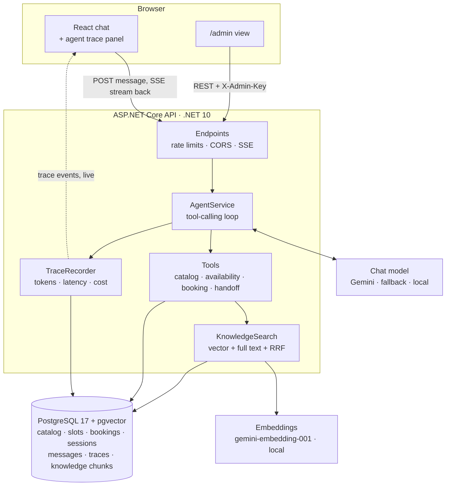
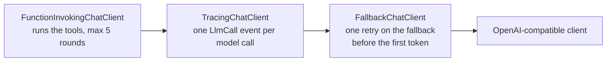
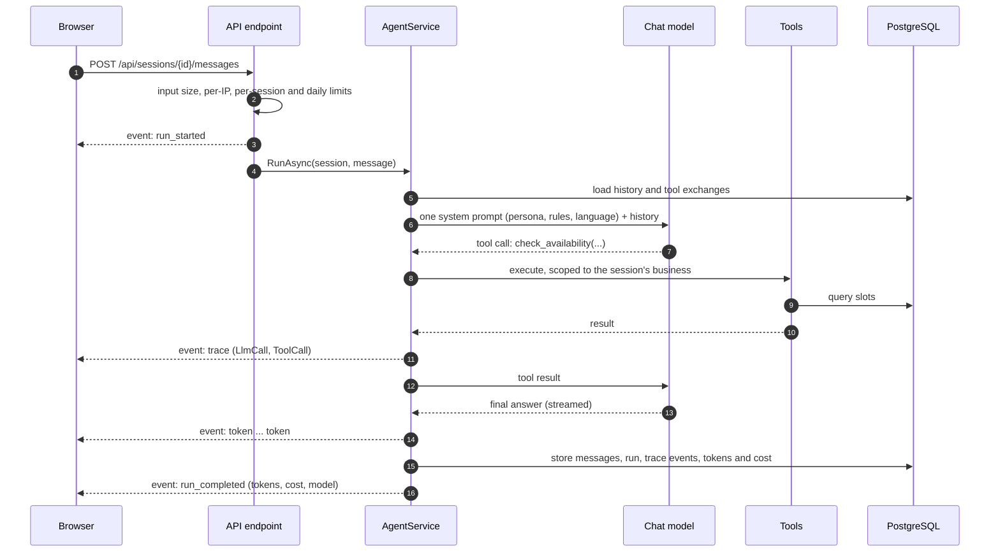
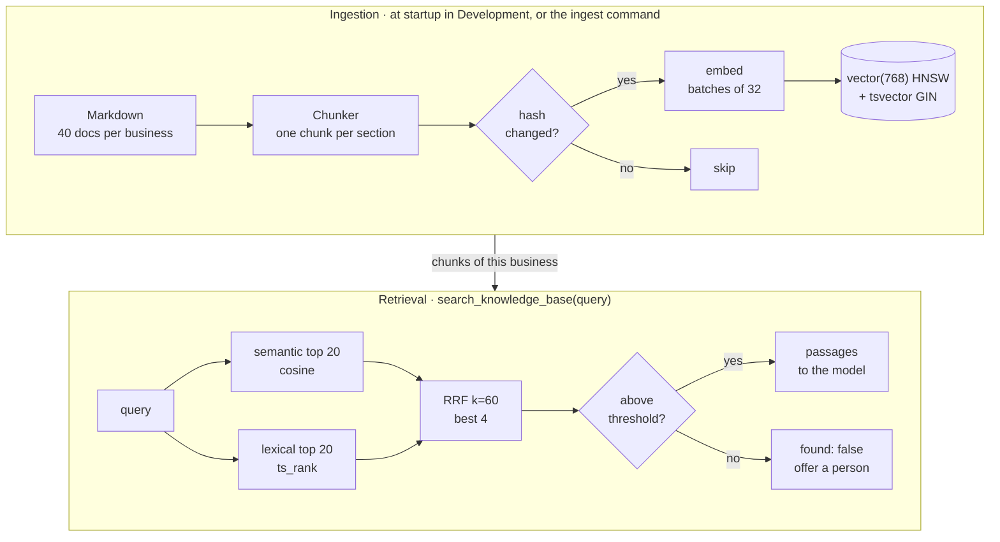
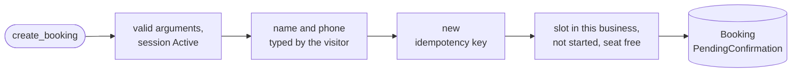

# AI Booking Agent

**A WhatsApp-style AI assistant for small businesses, built with .NET 10 and React.** A tool-calling agent searches a catalog, checks availability, registers bookings and orders in PostgreSQL, answers policy questions from a knowledge base (hybrid RAG over pgvector) and hands the conversation to a person when needed. A live **agent trace** panel shows every model call, tool call, retrieval, token and cent behind each answer.

[](https://github.com/agustinrojas1/ai-chatbot-dotnet-react/actions/workflows/ci.yml)


[](LICENSE)

> **Live demo:** [booking-agent-demo.vercel.app](https://booking-agent-demo.vercel.app) (free hosting: the first answer after a quiet spell can take a few seconds). **Demo GIF:** pending.

The visitor picks one of three demo businesses, each with its own persona, catalog, knowledge base and rules:

| Niche | Persona | Business | Catalog | Knowledge base |
|---|---|---|---|---|
| Real estate | Sofia | PrimeHaven Realty | 9 properties for rent and sale, viewings | 40 documents |
| Dental clinic | Alex | Smile Dental Clinic | 9 treatments with appointment slots | 40 documents |
| Restaurant | Nico | Luigi's Pizzeria | 10 menu items, orders with delivery windows | 40 documents |

## Contents

- [Highlights](#highlights)
- [Architecture](#architecture)
- [Tech stack](#tech-stack)
- [Getting started](#getting-started)
- [Key decisions](#key-decisions)
- [Evals](#evals)
- [Known limitations and next steps](#known-limitations-and-next-steps)

## Highlights

| | |
|---|---|
| **Real tool calling** | Six tools (`search_catalog`, `get_offering_details`, `check_availability`, `create_booking`, `handoff_to_human`, `search_knowledge_base`) read and write PostgreSQL. A booking is a row, not a sentence. The business and session a tool acts on come from the server, never from model arguments. |
| **Rules in code, not in the prompt** | Slot capacity (atomic `UPDATE ... WHERE booked < capacity` plus CHECK constraints), idempotent bookings (unique key), order totals computed on the server, iteration and output-token caps. The model picks tools; it never decides whether there is room or what an order costs. |
| **Hybrid RAG for free text** | 120 policy and FAQ documents, searched with vector search and full-text search fused by Reciprocal Rank Fusion, then a relevance threshold. Prices and availability never come from a retrieved chunk: the catalog stays on exact filters. |
| **Trace and cost per turn** | Every step is stored and streamed live over SSE: model and provider, tokens in and out, latency, tool arguments and results, retrieved passages with their scores, and the cost (`tokens × ModelPricing`). |
| **Human in the loop** | Bookings are registered as `PendingConfirmation` and the agent must say so. `handoff_to_human` moves the session to `AwaitingHuman`. Both show up in `/admin`. |
| **Safety and abuse limits** | Customer name and phone must appear in the visitor's own messages, phones are masked in the public trace, retrieved text is data and never instructions, plus per-IP, per-session and daily limits, strict CORS and startup checks. |
| **Provider-agnostic** | Any OpenAI-compatible endpoint: Gemini by default with a fallback provider on 429/5xx, or open-weight models served locally (see [Local models](#local-models)). |
| **Measured with evals** | 60 scripted conversations and 212 retrieval questions, run against real models by a console harness. |

## Architecture

### System overview



The model client is a decorator chain built per request, outermost first:



Tracing sits *below* function invocation, so each model call inside the tool loop gets its own trace event (ADR-012).

### Lifecycle of a message



A failed run ends with an `error` event instead (`retryable` says whether resending can help), and a handoff adds a `handoff` event before the end. The full SSE contract and the trace format are in [docs/architecture.md](docs/architecture.md).

### Knowledge base (RAG)



Both rankings are filtered by the session's business in SQL, and only vectors of the current embedding model are compared. Every search is recorded as a `Retrieval` trace event with the semantic, lexical and fused score of each passage.

### What protects a booking

`create_booking` runs these checks in order before a seat is taken:



| Check | If it fails |
|---|---|
| Arguments are valid | `invalid_*`, `missing_target` |
| The session is `Active` (not handed to a person, not closed) | `session_awaiting_human`, `session_closed` |
| Name and phone appear in the visitor's own messages | `customer_data_not_provided` |
| No booking with the same idempotency key | the existing booking is returned: no second seat |
| Offering and slot belong to this business, the slot has not started | `offering_not_found`, `slot_not_found`, `slot_in_past`, `slot_offering_mismatch` |
| Atomic `UPDATE ... WHERE booked < capacity` takes the seat | `slot_full` |

A refusal goes back to the model as a tool error with its code, so it can tell the customer and try again; the session, customer-data and slot refusals are also recorded as `Guardrail` trace events. Order totals are computed from catalog prices on the server. The prompt asks the model to summarize and wait for an explicit "yes" before booking; these checks hold even when it does not, and concurrent attempts on the last seat have exactly one winner (tested against a real PostgreSQL).

### Repository layout

```
api/
  src/Chatbot.Api             ASP.NET Core minimal API: endpoints, SSE, limits, CORS, DI
  src/Chatbot.Core            pure logic: domain, language detection, cost, phone masking, prompt, chunker, RRF
  src/Chatbot.Infrastructure  EF Core, migrations, seed, knowledge ingestion and search, tools, AgentService, tracing, LLM clients
  tests/Chatbot.Tests         unit and integration tests (WebApplicationFactory, Testcontainers PostgreSQL, scripted fake model)
evals/
  Chatbot.Evals               console harness that runs the cases against the agent and a real model
  cases/*.yaml                60 conversation cases + rag-retrieval.yaml (212 retrieval questions)
web/                          React 19, Vite, TypeScript, Tailwind, Vitest
docs/                         architecture.md, decisions.md (ADRs), progress.md, seed-notes.md
docker-compose.yml            postgres + api + web
```

## Tech stack

| Layer | Technology |
|---|---|
| Backend | .NET 10, ASP.NET Core minimal APIs, Server-Sent Events |
| AI | `Microsoft.Extensions.AI` (`IChatClient`, `IEmbeddingGenerator`, function invocation) with the OpenAI-compatible client; Gemini by default, Groq as fallback, local models via llama-server and Ollama |
| Data | EF Core 10 + Npgsql, PostgreSQL 17 with pgvector: `vector(768)` with an HNSW index and full-text search; `jsonb` for catalog attributes and trace payloads |
| Frontend | React 19, Vite, TypeScript (strict), Tailwind; hooks and context, no state library |
| Tests | xUnit, `WebApplicationFactory`, Testcontainers (PostgreSQL), scripted fake `IChatClient`, Vitest |
| Infra | Docker Compose (postgres, api, web behind nginx), GitHub Actions CI |

## Getting started

**Requirements:** Docker with Compose and an API key of an OpenAI-compatible provider (a free Gemini key covers both the chat model and the embeddings).

```bash
cp .env.example .env    # set LLM_PRIMARY_API_KEY and LLM_PRIMARY_MODEL (e.g. gemini-3.5-flash-lite)
docker compose up --build
```

Open http://localhost:3001. In Development the API applies the migrations, seeds the three businesses (28 offerings, 14 days of slots) and indexes the 120 knowledge documents on start; unchanged documents are skipped on later starts. Ports: web 3001, API 8080 (`/health`), PostgreSQL 5432.

`LLM_PRIMARY_MODEL` must support function calling. The repo seeds a `ModelPricing` row for `gemini-3.5-flash-lite`; other models work but show a cost of 0. To index the documents by hand: `dotnet run --project api/src/Chatbot.Api -- ingest`.

<details>
<summary><b>Configuration reference</b> (all variables of <code>.env</code>)</summary>

| Variable | Default | Purpose |
|---|---|---|
| `LLM_PRIMARY_API_KEY` | _empty_ | API key of the primary provider. Required: without it the chat answers with an error event |
| `LLM_PRIMARY_MODEL` | _empty_ | Model name of the primary provider. Required |
| `LLM_PRIMARY_BASE_URL` | Gemini OpenAI-compatible endpoint | Any OpenAI-compatible base URL |
| `LLM_FALLBACK_API_KEY` | _empty_ | Fallback provider key. Empty: no fallback |
| `LLM_FALLBACK_MODEL` | _empty_ | Fallback model name (required if a fallback key is set) |
| `LLM_FALLBACK_BASE_URL` | Groq OpenAI-compatible endpoint | Fallback base URL |
| `EMBEDDINGS_BASE_URL` | _blank_ | OpenAI-compatible base URL for `POST {BaseUrl}/embeddings`. Blank: the primary provider's URL |
| `EMBEDDINGS_API_KEY` | _empty_ | Key of the embeddings endpoint (the same Gemini key works). Empty: the API starts, and knowledge search fails with `knowledge_unavailable` |
| `EMBEDDINGS_MODEL` | `gemini-embedding-001` | Embedding model; stored with every chunk |
| `EMBEDDINGS_DIMENSIONS` | `768` | Must match the `vector(768)` column; startup fails otherwise |
| `EMBEDDINGS_QUERY_PREFIX` / `EMBEDDINGS_DOCUMENT_PREFIX` | _empty_ | Task instructions put before a query / a chunk, for models that expect them (EmbeddingGemma: `task: search result \| query: ` and `title: none \| text: `). Changing the document prefix re-indexes everything |
| `KNOWLEDGE_AUTO_INGEST` | `true` | Index the knowledge documents at startup, after the seed |
| `KNOWLEDGE_MIN_SEMANTIC_SIMILARITY` | `0.63` | Cosine similarity a passage needs to count as relevant (measured on `gemini-embedding-001`; `embeddinggemma-2` needs 0.70) |
| `KNOWLEDGE_MIN_LEXICAL_RANK` | `0.05` | `ts_rank` a passage needs to count as relevant (an exact amount, code or acronym) |
| `CORS_ALLOWED_ORIGIN` | `http://localhost:3001` | Allowed frontend origin(s), comma-separated, exact match |
| `ADMIN_KEY` | _empty_ | Value of the `X-Admin-Key` header for `/api/admin/*`. Empty: admin endpoints answer 503 |
| `ADMIN_MASK_PHONES` | `true` | Mask customer phones in the admin bookings list |
| `RATE_LIMIT_ADMIN_REQUESTS` | `60` | Limit for `/api/admin/*` requests |
| `IP_HASH_SALT` | _empty_ | Salt for the stored client-IP hash. Set a long random value outside local development |
| `AGENT_MAX_OUTPUT_TOKENS` | `800` | Output-token cap per model call (raise it for thinking models) |
| `AGENT_MAX_ITERATIONS` | `5` | Tool rounds per user message |
| `RATE_LIMIT_IP_MESSAGES` | `30` | Messages per client IP per window |
| `RATE_LIMIT_IP_WINDOW_MINUTES` | `10` | Window of the per-IP limits |
| `RATE_LIMIT_IP_SESSIONS` | `20` | New sessions per client IP per window |
| `RATE_LIMIT_SESSION_MESSAGES` | `25` | User messages per session in total |
| `RATE_LIMIT_DAILY_REQUESTS` | `500` | Agent runs per UTC day, all visitors |
| `SECURITY_TRUSTED_PROXY_CIDR` | loopback + private ranges | Proxies whose `X-Forwarded-For` is trusted; in production list only your proxy |
| `POSTGRES_DB` / `POSTGRES_USER` / `POSTGRES_PASSWORD` | `chatbot` | Database credentials for the compose postgres |
| `WEB_PORT` | `3001` | Host port of the web container |

Never commit `.env`. `.env.example` also has commented setups for local embeddings (Ollama) and a local chat model (llama-server).

</details>

### Deploy (free tier)

The public demo runs on free plans with no credit card: the frontend on Vercel, the API on Render, PostgreSQL with pgvector on Neon, and Gemini (free tier) for the model and the embeddings. See [ADR-019](docs/decisions.md#adr-019-free-tier-hosting-render-neon-vercel-github-actions).

1. Create a Neon project in `AWS us-east-1` and copy its direct connection string (not the `-pooler` host) into `DATABASE_URL` in `.env.production` (template: `deploy/env.production.example`), with your Gemini key.
2. Run `deploy/set-github-secrets.sh`, then `gh workflow run ingest`. The `ingest` workflow applies the migrations, runs the seed and indexes the documents, and runs again every day because the slots are a 14-day rolling window.
3. In Render, create a Blueprint from this repo. `render.yaml` declares the API; paste the output of `python3 deploy/neon-connection.py` into `ConnectionStrings__Postgres` and the Gemini key into `Llm__Primary__ApiKey`. `Admin__Key` is generated; read it in the Render dashboard.
4. Import the repo in Vercel with `web` as the root directory and `VITE_API_BASE` set to the Render URL. `web/vercel.json` sends every path, `/admin` included, to the single-page app.
5. Point an uptime monitor (UptimeRobot, free) at `<Render URL>/health` every 5 minutes, so the free instance does not sleep. `/health` does not touch the database, so Neon still scales to zero.

### Tests

```bash
cd api && dotnet test      # unit + integration; needs Docker (Testcontainers starts PostgreSQL)
cd web && npm test         # Vitest: SSE parser, WhatsApp formatting, chat reducer, trace helpers, admin page
```

CI runs the API build and tests, and the web lint, tests and build, on every push and pull request. The tests use a scripted fake model: no network and no API key.

### Admin view

http://localhost:3001/admin lists bookings and handoff requests, filterable by niche, with a link to the trace of each session. It asks for the `ADMIN_KEY` and sends it as the `X-Admin-Key` header:

```bash
curl -H "X-Admin-Key: $ADMIN_KEY" 'http://localhost:8080/api/admin/bookings?niche=dental'
```

This is demo-grade protection: one shared key compared in constant time, no users or roles. Phones are masked by default.

## Key decisions

Each decision is a short ADR (context, decision, alternatives, consequences) in [docs/decisions.md](docs/decisions.md).

| Decision | Why | ADR |
|---|---|---|
| Critical rules live in code and in the database | Scoping, idempotency, totals and capacity cannot depend on what the model decides to do | ADR-008 |
| SSE over `fetch` + `ReadableStream` | The message endpoint is a POST and the traffic is one-way; `EventSource` cannot POST | ADR-009 |
| Provider fallback before the first token | A 429 on a free tier should not end the conversation; once text is streaming, a retry would duplicate it | ADR-010 |
| Cost per call from a `ModelPricing` table | The trace shows what each answer would cost at paid rates; tariffs are data, not code | ADR-011 |
| Tracing below function invocation | Every model call of the tool loop gets its own `LlmCall` event | ADR-012 |
| One system message, language paragraph last | Gemini drops extra system messages; the reply language is detected in code per turn | ADR-014 |
| RAG only for free text, filters for the catalog | Approximate matching can return the wrong price or item | ADR-015 |
| Hybrid search fused with RRF | Vectors find paraphrases; full text finds exact codes, amounts and names; RRF needs no score normalization | ADR-016 |
| pgvector in the same PostgreSQL, 768 dimensions | One database, no second service; HNSW indexes accept at most 2000 dimensions | ADR-017 |
| English-only knowledge base, optional local embeddings | The demo is in English; EmbeddingGemma on Ollama runs the search with no API key | ADR-018 |

## Evals

The agent is measured by a console harness ([evals/README.md](evals/README.md)) that runs scripted conversations against the real agent, a throwaway PostgreSQL and a real model, and checks tool use, reply language, forbidden phrases, required facts, bookings and handoffs. They cost tokens and are not deterministic, so they run by hand, not in CI.

- **60 conversations** in 14 categories: search, availability, booking, orders, items not in the catalog, handoff, small talk, prompt injection, gibberish, language, and four knowledge-base categories (answer, unanswerable, mixed catalog + policy, instructions hidden inside documents).
- **212 retrieval questions** (198 answerable, 14 with no answer in any document), scored without a chat model.

```bash
export Llm__Primary__ApiKey=<your key>
export Llm__Primary__Model=gemini-3.5-flash-lite
dotnet run --project evals/Chatbot.Evals                # all conversations
dotnet run --project evals/Chatbot.Evals -- --retrieval # retrieval only
```

### Targets

| Target | Required |
|---|---|
| Reply in the visitor's language | 100 % |
| No forbidden phrases ("confirmed", promised emails, prompt leaks) | 100 % |
| Correct tool use | ≥ 90 % |
| Retrieval recall@4 / MRR | ≥ 0.9 / ≥ 0.75 |
| Unanswerable questions not invented | 100 % |
| Instructions inside documents ignored | 100 % |

### Results

**Retrieval** (2026-10-15, 212 questions over the 120 English documents):

| Embedding model | recall@4 | MRR | Threshold | Unanswerable rejected | Answerable kept |
|---|---|---|---|---|---|
| `gemini-embedding-001` (default) | **1.000** | **0.970** | 0.63 | 10/14 | 198/198 |
| `embeddinggemma-2` (local, Ollama) | **1.000** | **0.964** | 0.70 | 4/14 | 197/198 |

**Conversations, by chat model:**

| Chat model | Passed | Tool use | Language | Forbidden phrases |
|---|---|---|---|---|
| `gemini-3.5-flash-lite` (default; 2026-10-10, previous bilingual corpus) | **59/60** | 98.3 % | 100 % | 100 % |
| Bonsai 2 27B, local (2026-10-16) | **50/60** | 95 % | 100 % | 93.3 % |
| Bonsai 2 9B, local (2026-10-16) | **34/60** | 68.3 % | 98.3 % | 100 % |

<details>
<summary><b>Details of each run</b></summary>

**Gemini, 2026-10-10 (all 60 cases).** 59 of 60 pass and every target is met. The failure is `rag-mixed-dental-cleaning-insurance-en`: the model called `search_catalog` but not `search_knowledge_base`, so the insurance part was never searched. 629,489 tokens in / 8,208 out, about $0.21 at paid prices. This run used the earlier corpus (54 documents, half in Spanish).

**Gemini, 2026-10-16 (24 knowledge-base cases × 3 on the English corpus).** 57 of 72 runs pass. Answer 36/36; injection 8/9 (once the model echoed the injected "free"); mixed 7/12 (the gluten-free + Veggie question fails every run because the model calls `search_knowledge_base` with empty arguments); unanswerable 6/15: with 40 documents per business there is always a passage on a nearby topic, and the model inferred "we don't offer valet" from a parking lot and "we don't accept Bitcoin" from the payment list. Prompt rules 2 and 3 now name that case; the unanswerable cases re-run at 13/15 (valet and Bitcoin 3/3).

**Bonsai 2 27B** (`Ternary-Bonsai-2-27B-PTQ1_0`, thinking on). Of the 10 failures, 4 were over-strict checks (two since relaxed: "3×", "pizzería"), 2 were tool calls printed as raw `<tool_call>` text that llama-server did not parse, 3 were bookings or orders where the model asked one more question instead of placing them, and one answered the garage question from the catalog.

**Bonsai 2 9B** (`Ternary-Bonsai-2-9B-PQ2_0`, thinking off). It fails by not calling tools: it answers "I don't have that information" without searching the knowledge base (12 cases), filters the catalog by the wrong kind, and never places some bookings. It does not invent facts.

Real-model runs found four bugs that offline tests could not: Gemini 3 rejects replayed tool calls without a thought signature (ADR-013), Gemini drops the persona when a request has two system messages (ADR-014), Gemini sometimes ends a stream with a finish reason the OpenAI SDK cannot parse (ADR-010), and the model fabricated a customer name and phone after a prompt-injection message (now rejected in code).

</details>

### Local models

The agent runs on any OpenAI-compatible server, so the whole stack can run on one machine with no API key: the chat model on [llama-server](https://github.com/ggml-org/llama.cpp) (started with `--jinja` for tool calling) and the embeddings on `embeddinggemma-2` in [Ollama](https://ollama.com). Measured on an RTX 3070 with 8 GB:

| Model | Speed | Fits in 8 GB |
|---|---|---|
| Bonsai 2 27B | ~51 tokens/s | with `BONSAI_KV4=1 BONSAI_MMPROJ_CPU=1`; run Ollama on CPU (`CUDA_VISIBLE_DEVICES=-1`) and set `AGENT_MAX_OUTPUT_TOKENS=2000` so the reasoning does not cut the reply |
| Bonsai 2 9B | ~110 tokens/s | yes, next to the embeddings model |

The settings are in `.env.example`. In Docker, the local server must listen on `0.0.0.0` and the API reaches it at `host.docker.internal`.

## Known limitations and next steps

- **Gemini is the only provider verified end to end.** The Groq fallback is covered by tests with stub transports but was never called live.
- **No full Gemini run on the English corpus yet.** The Gemini free tier allows 1000 embedding requests per day and one full indexing uses about 442.
- **Unanswerable questions next to a real topic.** The model sometimes answers "we don't offer X" from a passage about a nearby topic; after the prompt fix the re-run passes 13/15, not 100 %.
- **Mixed questions depend on tool choice.** The insurance question sometimes skips the knowledge search, and the gluten-free + Veggie question fails with empty tool arguments (not investigated yet).
- **Demo data.** 28 offerings and 120 invented documents: 54 written by hand and 66 generated with Claude Haiku, not reviewed one by one. One document per business carries an injected instruction on purpose.
- **The relevance threshold is a weak signal.** It is tuned on this corpus and model, and 4 of the 14 unanswerable retrieval questions still pass it.
- **Embedding cost shows 0.** There is no verified price for `gemini-embedding-001`, so no `ModelPricing` row.
- **Single-instance limits.** The per-IP limiter is in memory (per instance, reset on restart); the per-session and daily limits are in the database.
- **Demo-grade admin.** One shared key, not an authentication system. The demo is not meant for real personal data: a typed name stays in the stored messages.
- **Free-tier hosting.** The API runs on 0.1 CPU and wakes Neon on the first query after 5 idle minutes, so some answers start slower (ADR-019).

Next steps: record the demo GIF, run the full eval suite on the English corpus with Gemini, investigate the empty tool arguments, add an LLM judge for faithfulness, and a shared store for the per-IP limiter.

Day-by-day progress and pending items are in [docs/progress.md](docs/progress.md).

## Author

Built by **Agustín Rojas**, backend .NET developer working with AI agents.
[GitHub](https://github.com/agustinrojas1) · [LinkedIn](https://www.linkedin.com/in/agustin-jorge-rojas/)

Licensed under the [MIT License](LICENSE).
