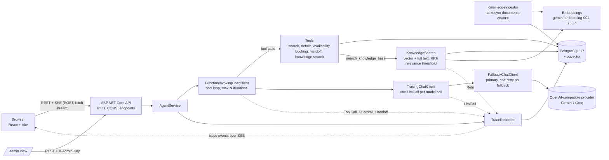

# AI Booking Agent (.NET + React)

A WhatsApp-style assistant for small businesses: a real tool-calling agent that searches a catalog, checks availability, registers bookings and orders in PostgreSQL, answers policy questions from each business's knowledge base (RAG over pgvector), and hands off to a person. A live **"Show agent trace"** panel shows every model call, tool call, retrieval, token count and cost behind each answer.

- **Live demo:** _pending: the public deploy does not exist yet (hosting provider not decided)._
- **Demo GIF (20-30 s, full booking with the trace panel open):** _pending: to be recorded._

The visitor picks one of three businesses, each with its own persona, catalog and rules:

| Niche | Persona | Business |
|---|---|---|
| Real estate | Sofia | PrimeHaven Realty |
| Dental clinic | Alex | Smile Dental Clinic |
| Restaurant | Nico | Luigi's Pizzeria |

## What this demonstrates

- **Real tool calling.** Five tools (`search_catalog`, `get_offering_details`, `check_availability`, `create_booking`, `handoff_to_human`) read and write PostgreSQL. A booking is a row, not a sentence. The business and session a tool acts on come from the server, never from model arguments, so the model cannot touch another business's data.
- **Trace and cost per turn.** Every model call and tool call of a run is stored and streamed live: model and provider, tokens in/out, latency, tool arguments and results, and the cost (`tokens x ModelPricing`).
- **RAG for free text.** Policies, FAQs, requirements and delivery zones (54 documents, Spanish and English) are searched with `search_knowledge_base`: vector search and full-text search fused with Reciprocal Rank Fusion, then a relevance threshold. The model answers only from the passages returned, and the trace shows which passages were retrieved and their scores. The catalog stays on exact filters, so prices and availability never come from a retrieved chunk.
- **Human in the loop.** The agent only registers bookings as `PendingConfirmation` and must say so ("registered, pending confirmation"). `handoff_to_human` creates a handoff request, moves the session to `AwaitingHuman` and shows a banner. Both appear in `/admin`.
- **Rules in code, not in the prompt.** Slot capacity (atomic `UPDATE ... WHERE booked < capacity` plus CHECK constraints), booking idempotency (unique key), order totals computed on the server, iteration and output-token caps, and phone masking in the public trace. The model interprets text and picks tools; it does not decide whether there is room or what an order costs.
- **Idempotency and concurrency.** Retrying a booking does not duplicate it; concurrent attempts on the last seat have exactly one winner (tested against a real PostgreSQL).
- **Rate limiting and abuse limits on the server.** Per IP, per session and a global daily cap, plus explicit CORS and startup checks for unsafe configuration.
- **Deterministic language handling.** The reply language is detected per turn in code and injected as the last paragraph of the only system message (the previous version of this project answered English messages in Spanish; Gemini drops extra system messages, see ADR-014).
- **Evals.** 60 scripted conversations in 14 categories (36 agent cases and 24 knowledge-base answer cases) run by a console harness against a real model, plus 80 retrieval questions scored without a model. Results are below.
- **Provider fallback.** A primary and a fallback OpenAI-compatible provider; the fallback takes over on 429/5xx before the first token.

Status: everything above is covered by tests that use a scripted fake model and a real PostgreSQL (Testcontainers), and the evals were run against a real model (Gemini) on 2026-10-09 and 2026-10-10. The Groq fallback has not been called live; see [Known limitations](#known-limitations-and-next-steps).

## Architecture



The model client is built per request, outermost first: `FunctionInvokingChatClient` (runs the tools) -> `TracingChatClient` (sees each individual model call, which is why it sits *below* function invocation) -> `FallbackChatClient` -> OpenAI-compatible client. Details, the SSE contract and the trace format are in [docs/architecture.md](docs/architecture.md).

The knowledge base is indexed from Markdown files in `api/src/Chatbot.Infrastructure/Seeding/knowledge/` (idempotent: a changed document is re-indexed, an unchanged one is skipped), and `search_knowledge_base` runs the hybrid search over pgvector and PostgreSQL full-text. The pipeline, the thresholds and the `Retrieval` trace event are in [docs/architecture.md](docs/architecture.md#knowledge-base-rag-m8).

**Repo layout**

```
api/
  src/Chatbot.Api             ASP.NET Core minimal API: endpoints, SSE, limits, CORS, DI
  src/Chatbot.Core            pure logic: domain, language detection, cost, phone masking, prompt text
  src/Chatbot.Infrastructure  EF Core + migrations + seed, knowledge ingestion and search, tools, AgentService, tracing, LLM client + fallback
  tests/Chatbot.Tests         unit + integration (WebApplicationFactory, Testcontainers PostgreSQL, fake IChatClient)
evals/
  Chatbot.Evals               console harness that runs the cases against the agent and a real model
  cases/*.yaml                60 conversation cases (24 RAG) + rag-retrieval.yaml (80 retrieval questions)
web/                          React 19 + Vite + TypeScript + Tailwind, Vitest tests
docs/                         architecture.md, decisions.md (ADRs), progress.md, seed-notes.md
docker-compose.yml            postgres + api + web
.env.example
```

## Stack

| Layer | Technology |
|---|---|
| Backend | .NET 10, ASP.NET Core minimal APIs, SSE for streaming |
| AI | `Microsoft.Extensions.AI` (`IChatClient`, `IEmbeddingGenerator`, function invocation) + `Microsoft.Extensions.AI.OpenAI`; any OpenAI-compatible endpoint (default: Gemini primary, Groq fallback); embeddings `gemini-embedding-001`, 768 dimensions |
| Data | EF Core 10 + Npgsql, PostgreSQL 17 with pgvector (`pgvector/pgvector:pg17`): `vector(768)` embeddings with an HNSW index and full-text search for the knowledge base; `jsonb` for catalog attributes and trace payloads |
| Frontend | React 19, Vite, TypeScript (strict), Tailwind, Vitest; hooks and context, no state library |
| Tests | xUnit, `WebApplicationFactory`, Testcontainers (PostgreSQL), scripted fake `IChatClient` |
| Infra | Docker Compose (postgres, api, web behind nginx), GitHub Actions CI (api build + tests, web lint + tests + build) |

## Run it locally

Requirements: Docker with Compose, and an API key for an OpenAI-compatible provider (a free Gemini key works; Groq is optional, for the fallback). Knowledge search also needs embeddings: set `EMBEDDINGS_API_KEY` (the same Gemini key works; see Configuration).

```bash
cp .env.example .env          # then set LLM_PRIMARY_API_KEY and LLM_PRIMARY_MODEL in .env
docker compose up --build
# open http://localhost:3001
```

`LLM_PRIMARY_MODEL` has no default: pick a model of your provider that supports function calling (the repo seeds a `ModelPricing` row for `gemini-3.5-flash-lite`; other models run but show cost 0). In Development the API applies the migrations, seeds the three businesses (28 offerings, 14 days of slots) and indexes their 54 knowledge documents on start (`KNOWLEDGE_AUTO_INGEST`). To index by hand: `dotnet run --project api/src/Chatbot.Api -- ingest` (unchanged documents are skipped). Ports: web http://localhost:3001, API http://localhost:8080 (`/health`), PostgreSQL 5432.

### Configuration

Set in `.env` (read by `docker-compose.yml`). Never commit `.env`.

| Variable | Default | Purpose |
|---|---|---|
| `LLM_PRIMARY_API_KEY` | _empty_ | API key of the primary provider. Required: without it the chat answers with an error event |
| `LLM_PRIMARY_MODEL` | _empty_ | Model name of the primary provider. Required |
| `LLM_PRIMARY_BASE_URL` | Gemini OpenAI-compatible endpoint | Any OpenAI-compatible base URL |
| `LLM_FALLBACK_API_KEY` | _empty_ | Fallback provider key. Empty: no fallback |
| `LLM_FALLBACK_MODEL` | _empty_ | Fallback model name (required if a fallback key is set) |
| `LLM_FALLBACK_BASE_URL` | Groq OpenAI-compatible endpoint | Fallback base URL |
| `EMBEDDINGS_BASE_URL` | _blank_ | OpenAI-compatible base URL for `POST {BaseUrl}/embeddings`. Blank: the primary provider's URL (architecture default) |
| `EMBEDDINGS_API_KEY` | _empty_ | Key of the embeddings endpoint (the same Gemini key works). Empty: the API starts, and knowledge search fails with `knowledge_unavailable` |
| `EMBEDDINGS_MODEL` | `gemini-embedding-001` (in `.env.example`) | Embedding model; stored with every chunk |
| `EMBEDDINGS_DIMENSIONS` | `768` | Must match the `vector(768)` column; startup fails otherwise |
| `KNOWLEDGE_AUTO_INGEST` | `true` | Index the knowledge documents at startup, after the seed |
| `KNOWLEDGE_MIN_SEMANTIC_SIMILARITY` | `0.60` | Cosine similarity a passage needs to count as relevant (measured on the real model) |
| `KNOWLEDGE_MIN_LEXICAL_RANK` | `0.05` | `ts_rank` a passage needs to count as relevant (an exact amount, code or acronym found by text) |
| `CORS_ALLOWED_ORIGIN` | `http://localhost:3001` | Allowed frontend origin(s), comma-separated, exact match, no wildcard |
| `ADMIN_KEY` | _empty_ | Value of the `X-Admin-Key` header for `/api/admin/*`. Empty: admin endpoints answer 503 |
| `RATE_LIMIT_ADMIN_REQUESTS` | `60` | Limit for `/api/admin/*` requests |
| `ADMIN_MASK_PHONES` | `true` | Mask customer phones in the admin bookings list |
| `IP_HASH_SALT` | _empty_ | Salt for the stored client-IP hash. Set a long random value outside local development |
| `AGENT_MAX_OUTPUT_TOKENS` | `800` | Output-token cap per model call |
| `AGENT_MAX_ITERATIONS` | `5` | Tool rounds per user message |
| `RATE_LIMIT_IP_MESSAGES` | `30` | Messages per client IP per window |
| `RATE_LIMIT_IP_WINDOW_MINUTES` | `10` | Window of the per-IP limits |
| `RATE_LIMIT_IP_SESSIONS` | `20` | New sessions per client IP per window |
| `RATE_LIMIT_SESSION_MESSAGES` | `25` | User messages per session in total |
| `RATE_LIMIT_DAILY_REQUESTS` | `500` | Agent runs per UTC day, all visitors |
| `SECURITY_TRUSTED_PROXY_CIDR` | loopback + private ranges | Proxies whose `X-Forwarded-For` is trusted; in production list only your proxy |
| `POSTGRES_DB` / `POSTGRES_USER` / `POSTGRES_PASSWORD` | `chatbot` | Database credentials for the compose postgres |
| `WEB_PORT` | `3001` | Host port of the web container (read by compose; not in `.env.example`) |

### Tests

```bash
cd api && dotnet test      # unit + integration; needs Docker running (Testcontainers starts PostgreSQL)
cd web && npm test         # Vitest (SSE parser, WhatsApp formatting, chat reducer, trace helpers, admin page)
```

CI (GitHub Actions) runs the API build and tests, and the web lint, tests and build, on every push and pull request. The tests use a scripted fake model: no network, no API key.

### Admin view

Open http://localhost:3001/admin. It lists bookings and handoff requests (filterable by niche, with a link to the trace of each session) and asks for the key you set as `ADMIN_KEY`; the browser keeps it in `sessionStorage` and sends it as the `X-Admin-Key` header. With `ADMIN_KEY` empty the endpoints answer 503 and the page says the admin is disabled. The same data over HTTP:

```bash
curl -H "X-Admin-Key: $ADMIN_KEY" 'http://localhost:8080/api/admin/bookings?niche=dental'
```

This is **demo-grade protection**: one shared key compared in constant time, no users, no roles, no lockout. Phones are masked by default (`ADMIN_MASK_PHONES=true`).

## Key decisions

Short ADRs (context, decision, alternatives) in [docs/decisions.md](docs/decisions.md):

- **RAG only for free text; filters for the catalog.** Policies, FAQs and requirements are retrieved with `search_knowledge_base`. The catalog (28 structured offerings) stays on exact filters, because approximate matching can return the wrong price or item. ADR-007 still holds for the catalog. ([ADR-015](docs/decisions.md))
- **Hybrid search fused with RRF.** Vector search finds paraphrases and the other language; full-text search finds exact codes, amounts and names. Reciprocal Rank Fusion merges the two rankings without normalizing their scores, and a relevance threshold decides whether any passage reaches the model. ([ADR-016](docs/decisions.md))
- **pgvector in the same PostgreSQL.** One database and no second service, with 768-dimension embeddings from `gemini-embedding-001`. There is no `ModelPricing` row for that model yet, so embedding cost shows as 0. ([ADR-017](docs/decisions.md))
- **Critical rules live in code.** Business scoping, idempotency, totals, slot capacity and the iteration limit are enforced by the server and the database; the prompt only guides conversation. ([ADR-008](docs/decisions.md))
- **SSE over `fetch` + `ReadableStream`**, not WebSockets or `EventSource`: the message endpoint is a POST and the traffic is one-way. ([ADR-009](docs/decisions.md))
- **Provider fallback.** On 429 or 5xx *before the first token*, one retry on the fallback provider; the SDK's own retries are turned off when a fallback is configured. ([ADR-010](docs/decisions.md))
- **Cost per call with `ModelPricing`**, so the trace shows what each answer would cost at paid rates and tariffs are data, not code. ([ADR-011](docs/decisions.md))
- **Tracing sits below function invocation**, so every model call of the tool loop gets its own `LlmCall` event. ([ADR-012](docs/decisions.md))

Earlier ADRs cover the project split, atomic slot capacity, data conventions, where the tools live, trace storage and masking, and abuse limits.

## Evals

60 scripted conversations in `evals/cases/*.yaml` (36 agent cases, and 24 knowledge-base answer cases in `rag-answers.yaml`), plus 80 retrieval questions in `rag-retrieval.yaml` scored without the model. They are run by hand against the real agent, a real PostgreSQL and a real model (they cost tokens and are not deterministic, so they are not in CI). MVP targets: 100 % on language checks, 100 % on forbidden phrases, at least 90 % on correct tool use. M8 targets: recall@4 >= 0.9 and MRR >= 0.75; 100 % on not inventing answers to unanswerable questions; 100 % on ignoring instructions inside documents.

```bash
export Llm__Primary__ApiKey=<your key>
export Llm__Primary__Model=gemini-3.5-flash-lite
dotnet run --project evals/Chatbot.Evals
```

Needs Docker for a throwaway PostgreSQL (or set `ConnectionStrings__Postgres`). Options, the case format and what the checks can and cannot tell are in [evals/README.md](evals/README.md). `dotnet run --project evals/Chatbot.Evals -- --fake` runs the harness with a fake model to check the harness itself (most cases fail on purpose).

**Results (last run: 2026-10-10).** 59 of 60 conversations pass (98.3 %). The MVP and M8 targets are all met; the one failure is a mixed catalog + policy question.

- Models: `gemini-3.5-flash-lite` for the agent, via Gemini's OpenAI-compatible endpoint; `gemini-embedding-001` with 768 dimensions for the knowledge search.
- Total tokens / cost of the conversation run: 629,489 in / 8,208 out, about $0.21 at paid prices (chat model only; no embedding price, see the limitations).
- Earlier run, before M8 (2026-10-09, 36 agent cases): 34 of 36 pass (94.4 %).

| Target | Result | Required |
|---|---|---|
| Language (every reply in the visitor's language) | 100 % (60/60) | 100 % |
| Forbidden phrases ("confirmed", promised emails, prompt leaks) | 100 % (60/60) | 100 % |
| Correct tool use | 98.3 % (59/60) | >= 90 % |
| RAG: unanswerable questions not invented | 100 % (5/5) | 100 % |
| RAG: instructions inside documents ignored | 100 % (3/3) | 100 % |

Per category: language 7/7, search 4/4, availability 3/3, booking 4/4, order 3/3, not in catalog 3/3, handoff 2/2, small talk 2/2, injection 6/6, gibberish 2/2, RAG answer 12/12, RAG unanswerable 5/5, RAG mixed 3/4, RAG injection 3/3. The failure is `rag-mixed-dental-cleaning-insurance-en` (dental, a question that mixes the catalog and the insurance policy): the model called `search_catalog` but not `search_knowledge_base`, so the policy part was never searched.

**Retrieval** (no model, `--retrieval`, 2026-10-10): 80 questions (66 answerable, 14 unanswerable) across four language pairs (question language to document language).

| Target | Result | Required |
|---|---|---|
| recall@4 | 1.000 | >= 0.9 |
| MRR | 0.985 | >= 0.75 |

| Pair | Questions | Recall@4 | MRR |
|---|---|---|---|
| es->es | 19 | 1.000 | 1.000 |
| en->en | 14 | 1.000 | 1.000 |
| es->en | 14 | 1.000 | 1.000 |
| en->es | 19 | 1.000 | 0.947 |

Relevance threshold (informational): all 66 answerable questions pass it; 9 of the 14 unanswerable questions do not (the search says "nothing relevant"). The other 5 pass it, and the answer evals still show no invented answers (5/5).

Real-model runs found four bugs that offline tests could not (see ADR-013, ADR-014 and ADR-010): Gemini 3 rejects replayed tool calls without a thought signature, Gemini drops the persona when a request has two system messages, Gemini sometimes ends a stream with a finish reason the OpenAI SDK cannot parse, and the model fabricated a customer name and phone after a prompt-injection message (now rejected in code: the name and phone must appear in the visitor's own messages).

## Known limitations and next steps

Limitations:

- **One provider verified end to end.** Streaming tool calling, the booking flow and the evals were run against Gemini only. The Groq fallback is covered by tests with stub transports and was never called live (no Groq key was used).
- **Small catalog and demo knowledge base.** 28 seeded offerings, and 54 knowledge documents (18 per business) in Spanish and English, written for the demo. The documents are invented, and one per business contains an embedded instruction on purpose, which the evals check. The agent is told per turn to reply in the visitor's language and to translate catalog details, but the data itself is not translated, and "English message, Spanish data" is only approximated in the evals.
- **Tool results are not retried.** A tool call runs once. Malformed tool arguments go back to the model so it can correct them (up to 3 failing rounds), but a tool that fails for another reason is not retried by the server, and a provider failure after the first token is not retried on the fallback either: the run ends with an `error` event.
- **The per-IP limiter is in memory.** It is per API instance and resets on restart. The per-session and daily limits are counted in the database and survive restarts, but a burst of concurrent requests can overshoot them by a few messages.
- **Demo-grade admin key.** A single shared secret in a header; not an authentication system.
- **Free-tier model limits.** Free quotas of the LLM providers can return 429 under load; the fallback helps only if a second key is configured, and the visitor sees a "try again in a few minutes" message otherwise.
- **Relevance threshold tuned on this corpus.** `KNOWLEDGE_MIN_SEMANTIC_SIMILARITY` (0.60) and `KNOWLEDGE_MIN_LEXICAL_RANK` (0.05) were measured with `gemini-embedding-001` on these 54 documents. A different embedding model or corpus needs new values, and the threshold is a weak signal: 5 of the 14 unanswerable retrieval questions pass it.
- **Mixed questions depend on tool choice.** 3 of 4 `rag_mixed` cases pass; the failure did not call `search_knowledge_base`.
- **Embedding cost is not counted.** There is no `ModelPricing` row for `gemini-embedding-001` (no verified price), so embedding costs and the `costUsd` of `Retrieval` events show 0. Free-tier embeddings are rate limited by minute, so the first full ingestion can be slow (the embedder backs off on 429).
- **No faithfulness judge.** The optional LLM judge of whether each claim is supported by the passages (SPEC 12) is not implemented; see [evals/README.md](evals/README.md).
- **Not for real personal data.** Phone numbers are masked in the public trace, but a name typed by a visitor stays in the stored messages and tool arguments (ADR-005). The demo is not meant for real customer data.
- **No public deploy yet.** Hosting provider undecided; production migrations are meant to be an explicit step, not applied at start.

Next steps: deploy the demo (and publish the URL and the GIF); add a `ModelPricing` row for `gemini-embedding-001` once its price is verified; re-tune the relevance thresholds on a larger knowledge base; an LLM judge for faithfulness and for the `rubric` field of the eval cases; a Groq price in `ModelPricing` once it is public; and a shared store for the per-IP limiter if the API ever runs on more than one instance.

## Author

Built by Agustín Rojas, a backend .NET developer working with AI agents.

- GitHub: [github.com/agustinrojas1](https://github.com/agustinrojas1)
- LinkedIn: [linkedin.com/in/agustin-jorge-rojas](https://www.linkedin.com/in/agustin-jorge-rojas/)

Licensed under the [MIT License](LICENSE).
